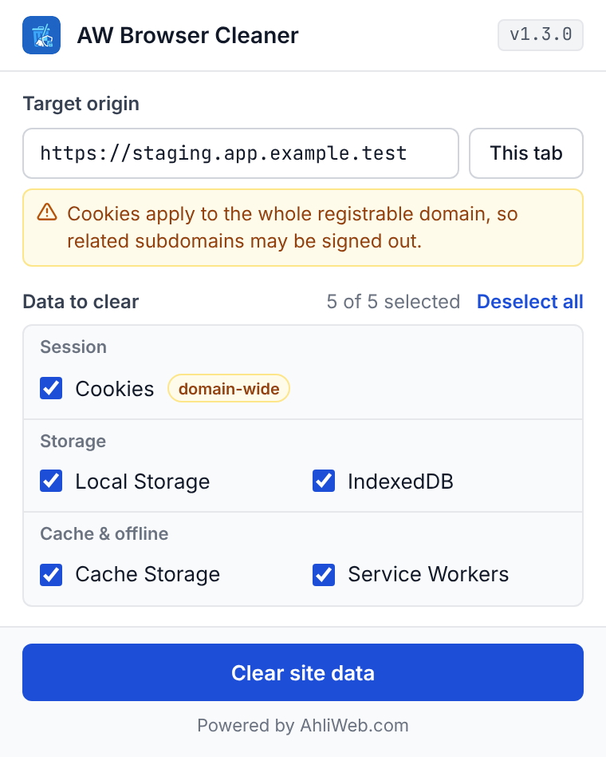
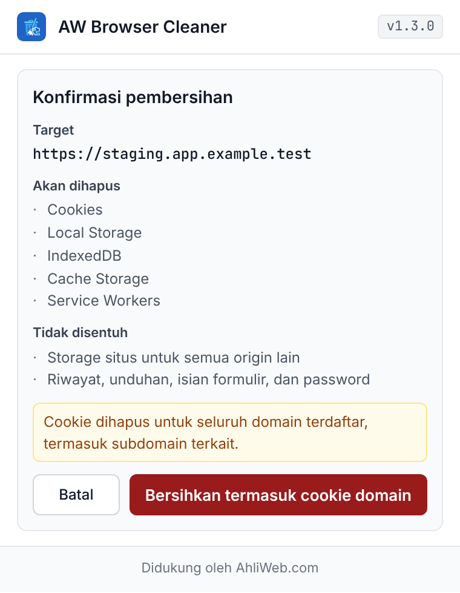
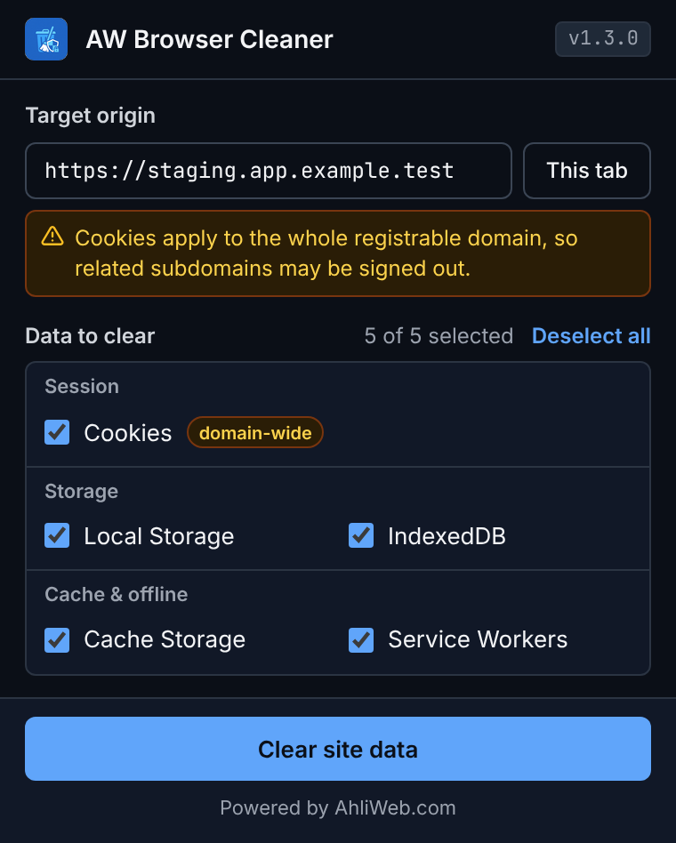

# AW Browser Cleaner

[](https://scorecard.dev/viewer/?uri=github.com/ahliweb/chrome-awbrowsercleaner)

Powered by AhliWeb.com

A lightweight, privacy-focused Chrome Extension that allows you to surgically clean browsing data (Cookies, Local Storage, IndexedDB, etc.) for the **specific origin** you are currently visiting.

Unlike the standard Chrome "Clear Browsing Data" dialog which often clears data for *all* sites or time ranges, this tool focuses on the *active tab's* exact origin (`scheme://host:port`), ensuring you don't lose sessions on other important sites.

## Scope principle

AW Browser Cleaner only ever cleans **exact origins** (`scheme://host:port`). It never touches browsing history, downloads, passwords, form data or other sites, and it has no "everything except" mode. Cookies do not isolate by port (RFC 6265 §8.5), so cookies use **Exact Cookie Mode** by default: only the cookies that apply to the target are removed and cookies shared with other subdomains are kept unless you choose them. Everything runs locally; nothing is ever sent off your device. See [docs/architecture.md](docs/architecture.md) and [docs/threat-model.md](docs/threat-model.md).

## Install from Chrome Web Store

[**AW Browser Cleaner** on Chrome Web Store](https://chromewebstore.google.com/detail/aw-browser-cleaner/njflkejajbifofomeebakgebgcincepf)

## Screenshots

| Light (EN) | Konfirmasi (ID) | Dark (EN) |
| --- | --- | --- |
|  |  |  |

## Features

- **Origin-Specific Cleaning:** Automatically detects the current tab's exact origin.
- **Granular Control:** Select exactly what to clear:
  - Cache Storage
  - Cookies (with registrable domain disclosure)
  - Local Storage
  - IndexedDB
  - Service Workers
- **Presets:** One-click **Log out**, **Fresh start**, **Fix stale files** and **Everything**, plus your own custom presets (import/export as JSON). A preset only pre-selects data types, cookie mode and the after-action; it never widens the scope.
- **Exact Cookie Mode:** Removes only the cookies that apply to the target origin (host-only and partitioned) and keeps shared domain cookies unless you tick them. Domain-wide removal exists behind a red confirmation. Cookie values are never shown.
- **More data types:** Session Storage, File Systems (OPFS) and the HTTP cache, besides the types above.
- **Evidence report:** Before/after counts after every cleanup. Copy a summary, or export JSON or Markdown (`aw-cleaner-<host>-<YYYYMMDD-HHmmss>.json`). Counts and metadata only: no cookie values or storage contents.
- **Shortcuts:** `Alt+Shift+K` cleans the current origin with the last preset, `Alt+Shift+L` with **Log out**.
- **Context menu:** "Clean this origin with preset…" lists every preset.
- **Several origins and time range:** Add extra exact origins (for example an API) and limit a cleanup to data created since a test session started.
- **Test Mode:** Off by default. Lets Playwright, Puppeteer or Selenium scripts run a preset on the page's own origin through a message. See [docs/automation.md](docs/automation.md).
- **Options page:** Presets, per-origin permissions, Test Mode, history (last 20 cleanups, can be turned off and cleared) and shortcuts.
- **Safe & Local:** All operations are performed locally. No data is sent to external servers.
- **Strict Input Validation:** Normalizes and validates URLs, hostnames, and IP addresses; every deletion passes one Scope Guard.
- **Bilingual UI:** English and Indonesian supported out of the box.
- **Minimal Permissions:** No permanent host access and no `tabs` permission; access to a single origin for Exact Cookie Mode is optional, asked per origin, and revocable.

## Installation (Developer Mode)

1. Clone or download this repository.
2. Open Chrome and navigate to `chrome://extensions/`.
3. Enable **Developer mode** (toggle in the top right).
4. Click **Load unpacked**.
5. Select the directory containing this project (`chrome-awbrowsercleaner`).

## Usage

1. Open the page you want to test (e.g. `https://staging.app.example.test/checkout`).
2. Click the **AW Browser Cleaner** icon. The target is the page's exact origin (`https://staging.app.example.test`); path, query and hash are never part of it. On pages that cannot be cleaned (`chrome://`, `file://`, extension stores) the popup explains why and lets you type a target.
3. Pick a preset (**Log out**, **Fresh start**, **Fix stale files**, **Everything**) or tick data types yourself. Counts per type come from a snapshot of the page.
4. Optional: add more exact origins (max. 10), choose a time range, and choose what happens after cleaning (hard reload, reload, open start page, nothing).
5. Click **Clear this origin**. Cookie cleanups show a confirmation built from the exact plan: blue for exact cookies, red when cookies of the whole registrable domain would be removed.
6. The result screen shows before/after counts and lets you copy a summary or export JSON/Markdown evidence.

Keyboard: `Alt+Shift+K` runs the last preset on the active tab, `Alt+Shift+L` runs Log out (change them at `chrome://extensions/shortcuts`). Settings live in the Options page (slider icon in the popup header).

## Development

### Prerequisites

- [Bun](https://bun.sh/) runtime — the exact version is pinned in `.bun-version` (CI and release use the same file).
- No Node.js, npm, or pnpm required.

### Setup

```bash
git clone https://github.com/ahliweb/chrome-awbrowsercleaner.git
cd chrome-awbrowsercleaner
bun install
```

### Available Scripts

| Script | Description |
| ------ | ----------- |
| `bun run test` | Run unit tests, then E2E tests |
| `bun run test:unit` | Run unit tests only |
| `bun run test:e2e` | Run E2E tests and the automation example test (needs Chrome for Testing or Chromium, see below) |
| `bun run lint` | Run ESLint |
| `bun run check:version` | Verify version synchronization across `manifest.json`, `package.json`, and `VERSION` |
| `bun run check:permissions` | Verify that `manifest.json` permissions are documented in `docs/PERMISSION_MATRIX.md` and `PRIVACY.md`, and that no `host_permissions` exist |
| `bun run build:package` | Build deterministic release ZIP with SHA-256 checksum |
| `bun run validate:package` | Validate release ZIP contents and integrity |
| `bun run upload:cws` | Upload release package to Chrome Web Store (requires API credentials) |
| `bun run setup:cws` | Interactive wizard to configure Chrome Web Store API credentials |

### Running E2E tests

The E2E suite loads the unpacked extension into a real browser and proves that data is actually deleted for the target origin only. It drives the popup, then reads cookies, localStorage, sessionStorage, IndexedDB, Cache Storage, Service Workers, OPFS and the HTTP cache on several fixture origins (`a.localtest.me`, `b.localtest.me`, a port variant and a `127.0.0.1` canary that must stay intact).

Branded Google Chrome 137+ ignores extension-loading flags, so use **Chrome for Testing** or Chromium:

```bash
bunx @puppeteer/browsers install chrome@stable --path ~/.cache/chrome-for-testing
AW_CHROME_PATH=/path/printed/above/chrome bun run test:e2e
```

- With `CI=true`, a missing browser or an extension that fails to load **fails** the run; it never passes silently.
- Locally, without a browser, the suites are skipped with a visible banner.
- The deletion matrix (data type × origin × result) is printed and written to `test-artifacts/e2e-matrix.md`; screenshots and console logs of failing tests are saved in `test-artifacts/`.
- `bun run test:e2e` also runs `tests/automation/cdp-example.test.js`, the tested CDP and Test Mode examples that [docs/automation.md](docs/automation.md) copies its code from.

### CI/CD

- **CI** (`.github/workflows/ci.yml`): Runs on push to `main` and PRs. The `validate` job runs the version check, ESLint, the permission documentation check, unit tests and package build/validation. The `e2e` job runs the E2E suite and the automation example on Chrome for Testing **stable** and **beta** (beta is non-blocking) and publishes the deletion matrix to the job summary.
- **Release** (`.github/workflows/release.yml`): Triggered by pushing a `v*` tag. Builds, validates, attests build provenance, attaches an SBOM, creates the GitHub Release and uploads to the Chrome Web Store behind the protected `chrome-web-store` environment. See [docs/SUPPLY_CHAIN.md](docs/SUPPLY_CHAIN.md).
- **Security**: CodeQL, OpenSSF Scorecard and Dependabot; all actions are pinned to commit SHAs.

### Chrome Web Store Automated Upload

See [docs/chrome-web-store/API_UPLOAD_SETUP.md](docs/chrome-web-store/API_UPLOAD_SETUP.md) for step-by-step setup of automated Chrome Web Store publishing via OAuth2 API.

Quick start:

```bash
bun run setup:cws
```

## Permissions

AW Browser Cleaner strictly adheres to the principle of least privilege. See [docs/PERMISSION_MATRIX.md](docs/PERMISSION_MATRIX.md) for full details.

- `activeTab`: Ephemeral access to the active tab's URL when the user opens the popup, uses a shortcut or the context menu.
- `browsingData`: Required to selectively remove site data via `chrome.browsingData.remove`.
- `contextMenus`: The "Clean this origin with preset…" menu.
- `cookies`: Exact Cookie Mode (cookie metadata only, never values).
- `scripting`: Counts what an origin stores and clears Session Storage in the page.
- `storage`: Presets, history summaries and settings, all local (see [docs/data-dictionary.md](docs/data-dictionary.md)).
- Optional, per origin: host access for Exact Cookie Mode, requested from a click and revocable in Options.

*No background tab tracking (`tabs`), no download access (`downloads`) and no persistent host permissions (`<all_urls>`) are requested. `bun run check:permissions` keeps this list in sync with the manifest.*

## Localization

The extension supports English (`en`) and Indonesian (`id`) out of the box.

To add a new language:

1. Create a new directory under `_locales/<language_code>/` (e.g., `_locales/es/messages.json`).
2. Copy `_locales/en/messages.json` into the new folder and translate each `"message"` property.
3. Keep message keys unchanged so popup elements map automatically.
4. Run `bun test` to verify parity across all locales.

## Documentation

| Document | Description |
| -------- | ----------- |
| [CHANGELOG.md](CHANGELOG.md) | Release history and version changes |
| [CONTRIBUTING.md](CONTRIBUTING.md) | Development setup, conventions, how to add a data type, release flow |
| [AGENTS.md](AGENTS.md) | Rules and module map for AI coding agents |
| [PRIVACY.md](PRIVACY.md) | Repository privacy policy |
| [SECURITY.md](SECURITY.md) | Security policy and vulnerability reporting |
| [docs/architecture.md](docs/architecture.md) | Module map, plan object, Scope Guard, popup DOM contract |
| [docs/qa-playbook.md](docs/qa-playbook.md) | QA scenarios with evidence reports (English); [Bahasa Indonesia](docs/qa-playbook.id.md) |
| [docs/automation.md](docs/automation.md) | CDP, Playwright and Cypress equivalents and Test Mode |
| [docs/data-dictionary.md](docs/data-dictionary.md) | Stored keys, plan, report, preset and message schemas |
| [docs/PERMISSION_MATRIX.md](docs/PERMISSION_MATRIX.md) | Feature-to-permission mapping |
| [docs/threat-model.md](docs/threat-model.md) | Extension threat model |
| [docs/SUPPLY_CHAIN.md](docs/SUPPLY_CHAIN.md) | Build and release supply-chain controls |
| [docs/chrome-web-store/RELEASE_CHECKLIST.md](docs/chrome-web-store/RELEASE_CHECKLIST.md) | Release checklist template |
| [docs/chrome-web-store/API_UPLOAD_SETUP.md](docs/chrome-web-store/API_UPLOAD_SETUP.md) | CWS API automated upload setup guide |
| [docs/chrome-web-store/STORE_LISTING.md](docs/chrome-web-store/STORE_LISTING.md) | Store listing draft |
| [docs/chrome-web-store/PUBLIC_PRIVACY_POLICY.md](docs/chrome-web-store/PUBLIC_PRIVACY_POLICY.md) | Public privacy policy for CWS |

## License

See the [LICENSE](LICENSE) file for details.
