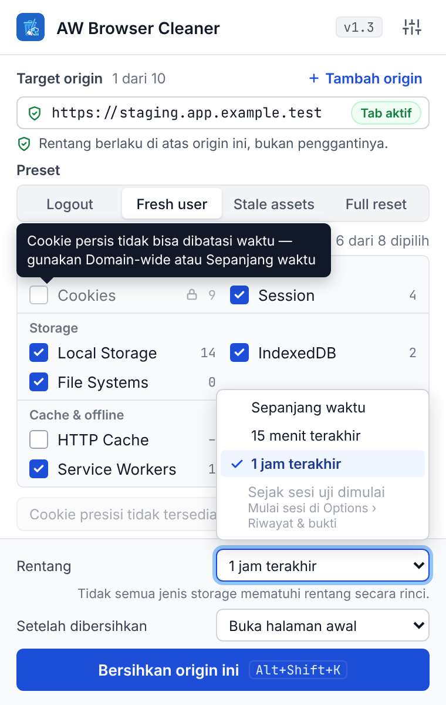
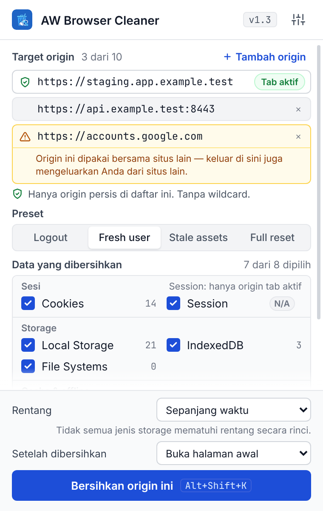
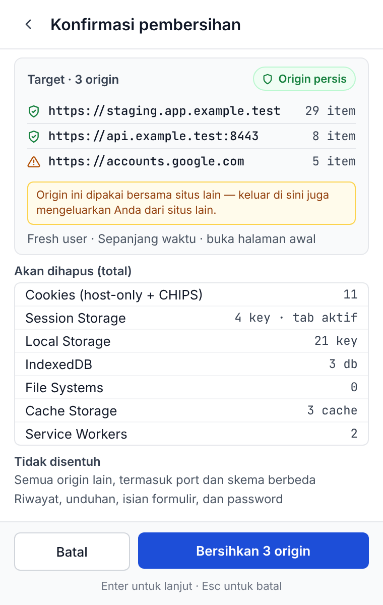
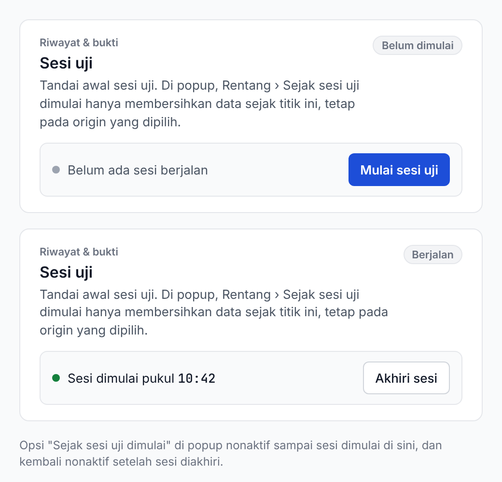

# Design — AW Browser Cleaner

Aset UI/UX dan perencanaan untuk roadmap v1.3–v1.5 (epic #43). Prinsip utamanya: **pembersihan hanya untuk origin persis (`scheme://host:port`) dari URL target, tidak pernah semua URL.**

Desain dibuat di kanvas Claude Design. Folder ini adalah salinan versi-terkontrol yang bisa dilihat tanpa akses ke kanvas tersebut.

## Isi folder

| Path | Isi |
| --- | --- |
| `exports/png/` | Render PNG @2x setiap papan (sumber gambar di bawah). |
| `exports/html/` | HTML statis setiap papan. Buka langsung di browser; link antar layar popup tetap berfungsi. |
| `canvas/` | Sumber asli kanvas: `canvas.json` (tata letak) dan `*.dc.html` (satu file per papan). Butuh runtime Claude Design untuk interaktivitas. |
| `tokens/tokens.json` | Token warna terang/gelap, tipografi, spasi, radius. Sumber kebenaran implementasi tetap `styles.css`. |
| `assets/` | Logo dan font (Inter, JetBrains Mono; SIL OFL 1.1) yang dipakai ekspor. |
| `tools/export-canvas.js` | Skrip untuk membuat ulang `exports/` dari `canvas/`. |

## Gaya visual


## Layar popup (380 × 600)

| 1 · Popup utama | 2 · Cookie presisi | 3 · Konfirmasi lingkup |
| --- | --- | --- |
|  |  |  |
| **4 · Hasil & bukti uji** | **5 · Halaman tidak didukung** | **Varian** |
|  |  | [Preset Stale assets](exports/png/PopupMain--preset-stale-assets.png) · [Cookie domain-wide](exports/png/PopupCookies--domain-wide.png) |

### Rentang waktu dan kumpulan origin (v1.3, #37 dan #38)

| 1b · Rentang waktu (#37) | 1c · Kumpulan origin (#38) | 3b · Konfirmasi beberapa origin |
| --- | --- | --- |
|  |  |  |

- **Rentang (`#rangeSelect`)** berada di footer, di atas "Setelah dibersihkan" (`#afterSelect`). Opsi: Sepanjang waktu (default), 15 menit terakhir, 1 jam terakhir, Sejak sesi uji dimulai (nonaktif sampai sesi dimulai). Rentang selalu berlaku di atas origin yang dipilih, tidak pernah menggantikannya.
- Saat rentang selain Sepanjang waktu dipilih dan Cookies dalam mode Origin persis, baris Cookies nonaktif (opacity 0,6) dengan tooltip bahwa cookie persis tidak bisa dibatasi waktu. Catatan di bawah select: tidak semua jenis storage mematuhi rentang secara rinci.
- **Sesi uji** dimulai dari Options › Riwayat & bukti:

  

- **Kumpulan origin**: origin utama adalah tab aktif (teks mono), origin tambahan berupa chip yang bisa dihapus lewat "+ Tambah origin" (maksimal 10). Setiap chip adalah origin persis `skema://host:port`, tanpa wildcard dan tanpa opsi "semua kecuali". Penyedia identitas pihak ketiga (accounts.google.com, login.microsoftonline.com, appleid.apple.com, github.com) menampilkan peringatan kuning karena dipakai bersama situs lain. Session Storage ditandai N/A untuk origin selain tab aktif. Konfirmasi (3b) mencantumkan setiap origin beserta jumlah item yang dihapus.
- Di 1c, isi popup menggulir saat daftar origin panjang (pegangan gulir dan pudar di tepi bawah).

Alur: Popup utama → (Atur) Cookie presisi → Konfirmasi → Hasil. Halaman `chrome://` membuka layar 5.

## Halaman Options


## Papan perencanaan

| Roadmap | Analisis celah | Standar & regulasi |
| --- | --- | --- |
|  |  |  |

## Status implementasi

| Layar / fitur | Status | Issue / PR |
| --- | --- | --- |
| Gaya visual, token, font lokal, konfirmasi | Diimplementasikan | PR #44 (menutup #28) |
| Cookie presisi (layar 2) | Diimplementasikan (v1.3.0) | #32 |
| HTTP Cache, File Systems | Diimplementasikan (v1.3.0) | #29 |
| Session Storage + reload | Diimplementasikan (v1.3.0) | #30 |
| Preset (layar 1, Options) | Diimplementasikan (v1.3.0) | #34 |
| Shortcut & context menu | Diimplementasikan (v1.3.0) | #35 |
| Hasil & bukti uji (layar 4) | Diimplementasikan (v1.3.0) | #36 |
| Test Mode (Options) | Diimplementasikan (v1.3.0) | #39 |
| Halaman Options (layar 6) | Diimplementasikan (v1.3.0) | #47 |
| Halaman tidak didukung (layar 5) | Diimplementasikan (v1.3.0) | #48 |
| Rentang waktu (layar 1b, Options sesi uji) | Diimplementasikan (v1.3.0) | #37 |
| Kumpulan origin (layar 1c, 3b) | Diimplementasikan (v1.3.0) | #38 |

Angka, domain, dan tanggal di desain adalah data contoh.

## Membuat ulang ekspor

```bash
bun install
node design/tools/export-canvas.js
# atau dengan Chrome tertentu:
CHROME_PATH=/path/to/chrome node design/tools/export-canvas.js
```

Folder `design/` tidak ikut dalam paket ekstensi (`scripts/build-package.js` hanya memaketkan file runtime).
